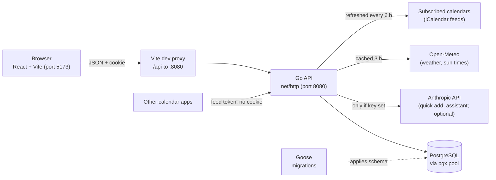
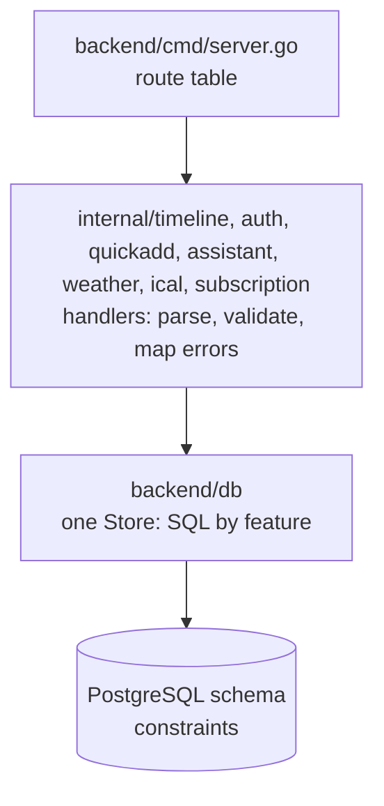
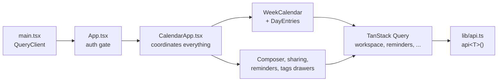

# Architecture

## The parts

- **Browser:** draws the week grid and forms. It sends requests and shows answers. It holds no authority.
- **Go API:** owns authentication, authorization, validation, and persistence.
- **PostgreSQL:** stores everything. Constraints back up the rules the API checks.
- **Goose:** applies the numbered SQL files in `backend/db/migrations`. You run it. It is not part of the server.
- **Anthropic, Open-Meteo, and subscribed calendars:** optional. Only the API calls them.
- **Other calendar apps:** fetch published feeds by their secret address, without a session.

In development, Vite serves the frontend and forwards `/api` to the Go server. The browser sees one origin, so the session cookie works.

## Backend layers

| Layer                     | Does                                                                             | Does not                                                                      |
| ------------------------- | -------------------------------------------------------------------------------- | ----------------------------------------------------------------------------- |
| Route table (`server.go`) | Maps a URL and method to a handler.                                              | Contain logic.                                                                |
| Handler                   | Reads the user, decodes JSON, validates, calls the store, maps errors to status. | Write SQL.                                                                    |
| Store (`backend/db`)      | Runs SQL, in transactions where needed. Filters by owner on every write.         | Know about HTTP.                                                              |
| Schema                    | Enforces relationships and basic rules, such as an end after a start.            | Know about requests. Rules apply to every write, even ones that skip the API. |

There is **no service layer**, on purpose. See [decisions](decisions.md#no-service-layer).

## Packages

| Path                             | Contents                                                                                                      |
| -------------------------------- | ------------------------------------------------------------------------------------------------------------- |
| `backend/cmd/server.go`          | Starts the server, loads env files, builds handlers, registers all routes.                                    |
| `backend/internal/auth/`         | Register, login, logout, `me`. Argon2id passwords, session cookie.                                            |
| `backend/internal/timeline/`     | Handlers for events, tasks, tags, sharing, reminders, households, transit card. Validation and error mapping. |
| `backend/internal/quickadd/`     | `POST /api/events/parse`. Sends text to Anthropic, returns a draft. Never writes.                             |
| `backend/internal/assistant/`    | Agent loop over calendar tools. Creates events at once; other changes wait for the user's decision.           |
| `backend/internal/ratelimit/`    | Per-user fixed-window rate limit, in memory. Used by quick add and the assistant.                             |
| `backend/internal/weather/`      | `GET /api/weather`. Fetches from Open-Meteo and caches in the database.                                       |
| `backend/internal/recurrence/`   | Repeat rules: validation, RRULE text, and expanding a series into occurrences. No database or HTTP.           |
| `backend/internal/ical/`         | `.ics` import, export, and published feeds. Parses and writes iCalendar with `arran4/golang-ical`.            |
| `backend/internal/subscription/` | Subscribed calendars: fetching with the private-address guard, refreshing, and their routes.                  |
| `backend/internal/testutil/`     | Starts a PostgreSQL container for tests, and one database per test.                                           |
| `backend/db/`                    | `Store` and its SQL, split by feature. `models.go` has row types, `errors.go` the sentinel errors.            |
| `backend/db/migrations/`         | Goose files `N_name.sql`, numbered 1 to 28 so far.                                                            |
| `frontend/src/`                  | See [frontend](frontend.md).                                                                                  |

## Where to change things

| You want to...                                | Start here                                                                 | Also look at                                                                |
| --------------------------------------------- | -------------------------------------------------------------------------- | --------------------------------------------------------------------------- |
| Add or change an API route                    | `backend/cmd/server.go`                                                    | The domain's handler file                                                   |
| Change login or sessions                      | `backend/internal/auth/handler.go`                                         | `backend/db/users.go`, migration 2                                          |
| Change event or task rules                    | `backend/internal/timeline/validation.go`                                  | Constraints in migrations 1, 3, 11, 14, 18, 19, 20                          |
| Change event or task storage                  | `backend/db/events.go`, `backend/db/tasks.go`                              | Migrations 1 and 3                                                          |
| Change repeat rules or occurrences            | `backend/internal/recurrence/`, `backend/internal/timeline/scopes.go`      | `backend/db/occurrences.go`, migration 25; `frontend/src/lib/recurrence.ts` |
| Change sharing or per-recipient fields        | `backend/db/sharing.go`, `backend/db/timeline.go`                          | Migrations 4, 5, 16; `frontend/src/features/sharing/`                       |
| Change customizing of received events         | `backend/internal/timeline/customization.go`                               | `db/customizations.go`, migration 29; `features/receivedCustomization/`     |
| Change tags, defaults, or attachment          | `backend/db/tags.go`                                                       | Migrations 6, 7, 8, 9, 10                                                   |
| Change reminders                              | `backend/db/reminders.go`, `backend/internal/timeline/reminders.go`        | Migrations 21 and 26                                                        |
| Change transit-card declarations or conflicts | `backend/db/transit_card.go`, `backend/internal/timeline/transit_card.go`  | Migration 12; `frontend/src/features/transitCard/`                          |
| Change households                             | `backend/db/households.go`, `backend/internal/timeline/household.go`       | Migration 15; `frontend/src/features/household/`                            |
| Change weather icons or caching               | `backend/internal/weather/`                                                | Migrations 22, 23; `frontend/src/features/weather/`                         |
| Change quick add                              | `backend/internal/quickadd/`                                               | `frontend/src/features/quickAdd/`                                           |
| Change .ics import or export                  | `backend/internal/ical/` (`parse.go`, `encode.go`)                         | `backend/db/ical.go`, migration 24; `frontend/src/features/icalendar/`      |
| Change published feeds                        | `backend/internal/ical/feeds.go`, `backend/db/feeds.go`                    | Migration 27; `frontend/src/features/feeds/`                                |
| Change subscriptions or their refresh         | `backend/internal/subscription/`, `backend/db/subscriptions.go`            | Migration 28; `frontend/src/features/subscriptions/`                        |
| Change the assistant or add a tool            | `backend/internal/assistant/tools.go` (registry), one file per tool        | `frontend/src/features/assistant/`                                          |
| Change what counts as busy                    | `backend/internal/assistant/busy.go` and `frontend/src/lib/timeline.ts`    | `frontend/src/lib/testdata/occupied-spans.json`                             |
| Change the JSON shape of a timeline entry     | `TimelineEntry` in `backend/db/models.go`                                  | Frontend `types.ts` and grid rendering                                      |
| Change week navigation or date math           | `frontend/src/lib/calendar.ts`, `features/calendar/useCalendarState.ts`    | `date-fns`                                                                  |
| Change where an event block sits              | `layoutDayEntries` in `features/calendar/timelineView.ts`                  | `features/calendar/DayEntries.tsx`, `.grid-entry` in `styles/calendar.css`  |
| Change hour height                            | `--hour-height` in `frontend/src/styles/calendar.css`                      | `gridOffset` in `lib/calendar.ts`, `--hour-height-min/max` in `tokens.css`  |
| Change the create-item form                   | `frontend/src/features/composer/`, `features/timeline/timelineRequests.ts` | Backend request structs and validation                                      |
| Change caching or loading                     | `frontend/src/lib/queryKeys.ts`, `lib/queryInvalidation.ts`                | Feature hooks such as `features/timeline/useTimeline.ts`                    |
| Change colors or layout                       | `frontend/src/styles/`                                                     | `frontend/src/index.css` for global rules                                   |

## Request flow

1. The browser sends the `calendar_session` cookie. JavaScript cannot read it (`HttpOnly`).
2. The auth code hashes the token and looks up an unexpired session. Only the hash is stored.
3. The handler gets the user through `requireUser`. Every handler that needs a user must call it first. Nothing applies it automatically.
4. The handler validates the request.
5. The store runs SQL with `user_id = <caller>`. This is the second ownership check.
6. Constraints enforce the rest.
7. The handler returns JSON, or plain text with a status code.

Steps 4 and 5 both check ownership, so a guessed UUID cannot change another user's data. [Walkthroughs](walkthroughs.md) show this in code.

## Errors

- Success returns JSON, or `204 No Content`.
- Errors are plain text (`http.Error`). The frontend shows the text as-is.
- "Not yours" and "does not exist" both return `404`, so IDs cannot be probed.
- Unknown database errors return `500` with a generic message. The real error is logged.

## Frontend

More detail: [frontend](frontend.md).
