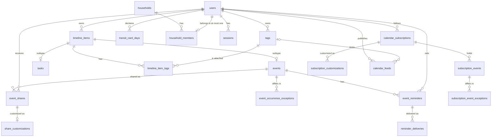

# Data model



`weather_forecasts` has no owner, so it is not in the diagram. See [weather cache](#weather-cache).

## Ownership

- `timeline_items.user_id` is the only place that stores who owns an event or task.
- `events` and `tasks` are subtype rows keyed by `timeline_item_id`. The API uses that ID as the event or task ID.
- A write to both a parent and a subtype row runs in one transaction. Example: `Store.CreateEvent` (`backend/db/events.go`) writes `timeline_items`, `events`, and the first `timeline_item_tags` row together. If one fails, all roll back.

## Demo users

- A user with `demo_expires_at` set (migration 31) is a demo account, made by `POST /api/auth/demo` with sample data (`backend/internal/demo`).
- Its email ends in `@demo.invalid` and its password hash is not a valid hash, so no one can log in as it, share with it, or add it to a household.
- The hourly cleanup job deletes it once `demo_expires_at` passes. Every foreign key to `users` cascades, so everything it owns goes with it.
- Demo users cannot share, create or join a household, or add or refresh subscriptions (`auth.RejectDemo`), so they cannot reach real users or make the server fetch URLs.

## Events

An event stores:

- `starts_at` and `ends_at` (`TIMESTAMPTZ`);
- `start_is_approximate` and `end_is_approximate`, which only change how the edge is drawn;
- `is_all_day`;
- `kind`: `attendable` (you must be there) or `informational` (on the calendar, not busy);
- `is_skipped`, allowed only on `attendable` events;
- `location`;
- commute before and after, in seconds (whole minutes);
- gathering before the start, in seconds, with an optional flag and label;
- an optional repeat rule. See [repeating events](#repeating-events).

Schema constraints:

- All-day events cannot have commute (migration 14), gathering (migration 19), or approximate edges (migration 18).
- Only attendable events can be skipped (migration 20). An all-day attendable event can be skipped.

### All-day events

- An all-day event ends at **midnight after its last day**. A one-day event on 12 October ends at 00:00 on 13 October.
- The frontend builds that value. The API only checks `ends_at > starts_at`. See [gotchas](gotchas.md#all-day-end-is-exclusive).

### Repeating events

- A repeating event is an ordinary event with a rule (migration 25): `recurrence_rule` (an RRULE value), `recurrence_time_zone` (the IANA zone its wall-clock times repeat in), and `recurrence_ends_at` (when the last occurrence ends, NULL when it never ends).
- `starts_at` and `ends_at` are the **first occurrence**. Occurrences are not stored: `backend/internal/recurrence` expands them on read, in the series' zone, so 10:00 stays 10:00 across daylight saving changes.
- `GET /api/timeline` finds series that may have an occurrence in its range through `recurrence_ends_at`, then `timeline.ExpandTimeline` expands them. The assistant and the reminder list use the same expansion.
- `event_occurrence_exceptions` holds the occurrences that differ from their series, keyed by `(event_id, original_start)`, the start the rule gives them (an iCalendar RECURRENCE-ID). An occurrence can be cancelled, moved (`starts_at`, `ends_at`), or skipped. Nothing else differs per occurrence.
- An exception's `is_skipped` is the owner's own decision and is never sent to recipients.
- The handler works out the rule, the end, and which exceptions still match it (`backend/internal/timeline/scopes.go`). The store writes what it is given and checks ownership.
- "This and following" is `Store.SplitSeries`. In one transaction it ends the old series the day before the occurrence, creates a new series, and copies the tags, the shares with their per-recipient fields, and everyone's reminders. Later exceptions move to the new series when they still match it.

### Gathering and commute

- **Commute:** travel to and from the event.
- **Gathering:** time at the event before it starts, such as getting ready.
- Mandatory gathering is part of the event block.
- Optional gathering is a dotted band. It counts as busy only when there is a commute before it.
- Shared events never include the owner's commute. Gathering is shared, because it describes the event.

### iCalendar UIDs

- `timeline_items.ical_uid` (migration 24) holds the UID an event was imported with. It is NULL for events made in the app.
- It is unique per user, so importing the same file again skips the events it already created. Imported events are never updated from a file.
- Exported events use `ical_uid`, or `<id>@jonska-calendar` for events made in the app. Importing your own export skips those events too; another user importing it gets new events.
- An event in a file without a UID cannot be recognized, so it is imported again each time.
- `Store.ImportEvents` (`backend/db/ical.go`) writes all events, tags, and reminders in one transaction. A preview runs the same transaction and rolls it back.

## Subscriptions

```text
calendar_subscriptions (user_id, name, url, color, time_zone, last_fetched_at, last_success_at, last_error)
  └── subscription_events (subscription_id, uid, the event fields)
        └── subscription_event_exceptions (original_start, is_cancelled, starts_at, ends_at)
```

- A subscription is a calendar the user follows by URL (migration 28). Its events are a **projection** of the feed, like shares: read-only, never in `timeline_items`, and owned through `calendar_subscriptions.user_id`.
- `subscription_events` mirrors `events` without the owner's own fields: no tags, commute, or skipping. Its checks repeat the event constraints. Exceptions mirror `event_occurrence_exceptions` without `is_skipped`.
- A refresh replaces all of a subscription's events and exceptions in one transaction (`Store.ReplaceSubscriptionEvents`, `backend/db/subscriptions.go`). The rows are copied in with `COPY`, because a feed can hold thousands of events. Updating the subscription row first serializes two refreshes of one subscription.
- A failed refresh sets `last_error` and `last_fetched_at` and keeps the events of the last success.
- `time_zone` is the subscriber's browser zone. Floating times and all-day dates in the feed are read in it.
- The URL is unique per user.
- `uid` (migration 29) is the feed's UID, NULL when it gave none. It is not unique, since a feed may repeat one. It is what recognizes an event across refreshes, which recreate the rows. See [customizations](#customizations).
- `listSubscribedTimeline` adds the events to `ListTimeline`, with the subscription as `{id, name, color}`. They expand like other series.
- `Refresher.Run` (`backend/internal/subscription/refresh.go`) checks every 15 minutes for subscriptions last fetched more than 6 hours ago and refreshes them one at a time. It runs in the API process, beside the hourly cleanup job.

## Feeds

```text
calendar_feeds (user_id, name, token UNIQUE, tag_id → tags ON DELETE CASCADE, include_alarms, time_zone)
```

- A feed publishes the user's own events at `/api/feeds/<token>/calendar.ics` (migration 27). The token is 32 random bytes, base64url. It is the only credential, and it is stored as is so the address can be shown again. Hashing it would not protect anything: whoever can read the table can read the events it serves.
- A feed with `tag_id` publishes only events with that tag. Deleting the tag deletes the feed, so it never widens to every event.
- The events come from the export query (`listEventsForExport`, `backend/db/ical.go`), so a feed and a download write the same file, except that a feed leaves out the owner's commute and skips (`EncodeFeed`), as sharing does. Gathering stays. Reminders are the owner's and are left out unless `include_alarms` is set.
- `time_zone` is the creator's browser zone, used for all-day dates.

## Tasks

- Stores a title, optional description and URL, `deadline_at`, and `is_completed`.
- No start time or duration.
- The app does not offer tags on tasks. The tag endpoints accept any owned item, so the API would accept them.
- Drawn as a fixed block at its deadline.
- Cannot be shared.

## Tags

```text
users 1 ─── n tags
tags  n ─── n timeline_items   (through timeline_item_tags)
```

- A tag belongs to one user. Names are unique per user; a duplicate returns `409`.
- `default_tag_id` is used for new events when none is chosen.
- Every event has at least one tag, and its `main_tag_id` is one of them.
- Removing an event's main tag returns `409`. See [gotchas](gotchas.md#removing-the-main-tag).

Deleting a tag runs in one transaction, `Store.DeleteTag` (`backend/db/tags.go`):

- events whose main tag was deleted get the replacement as main tag;
- events left with no tags get the replacement attached;
- if the deleted tag was the default, the replacement becomes the default;
- the tag is deleted.

The replacement is the alphabetically first remaining tag. The last tag cannot be deleted (`409`).

Always delete through `Store.DeleteTag`. `events.main_tag_id` has a foreign key with no `ON DELETE` rule, so a direct `DELETE` fails while events use the tag.

## Sharing

```text
events ─── event_shares ─── recipient_user_id
            (title, description, url, location: owner-set, nullable)
```

A share is a **projection**, not a copy. Nothing is written to the recipient's `timeline_items`. The recipient's view reads the event and uses the share's value for each field the owner set.

- **Owner:** not stored on `event_shares`. Found through `event_shares.event_id → events.timeline_item_id → timeline_items.user_id`. Storing it twice could make the two disagree.
- **Per-recipient fields:** `title`, `description`, `url`, `location`. A NULL field means "use the event's current value", so later edits still reach the recipient.
- **Always from the event:** times, all-day, approximate flags, kind, and gathering.
- **Never sent to recipients:** tags, `main_tag_id`, commute, `is_skipped`.
- **Read-only for recipients.** Only the owner manages shares.
- Sharing with yourself returns `400`. Sharing twice with the same person returns `409`.
- Migration 16 removed `event_share_overrides`, which let recipients keep their own copy of some fields.

`ShareEvent` (`backend/db/sharing.go`) is one `INSERT ... SELECT`. It checks ownership, that the event exists, and that the recipient is not the owner.

## Customizations

```text
event_shares ─── share_customizations (event_share_id PK)
calendar_subscriptions ─── subscription_customizations (subscription_id, event_uid PK)
  (title, description, url, location, note, start_shift_seconds, end_shift_seconds,
   commute_before_seconds, commute_after_seconds, gathering_seconds, gathering_is_optional, gathering_label)
```

A recipient's own version of an event they receive (migration 29). Like a share, it is applied on read, never copied.

- **Recipient:** not stored. Found through the share's `recipient_user_id` or the subscription's `user_id`. The owner of a shared event never reads these tables.
- **Layers:** the event's values, then the owner's per-recipient share fields, then the recipient's customization. A NULL field and a zero shift keep the received value, so later changes at the source still show.
- **Commute** (migration 30) is the recipient's own: received events never carry the owner's. **Gathering** is shared, so `gathering_seconds` NULL keeps the received gathering, and a value replaces it with its flag and label (`0` removes it). Both apply only to timed attendable events, decided when shown, since the owner may change the event.
- **Shifts** move the start and end by whole minutes, at most a day (`MaxShiftSeconds`). They are left out on all-day events and when the shifted event would not end after it starts.
- **Where it applies:** `customize` in `backend/internal/timeline/customization.go`, called by `ExpandTimeline` for each event or occurrence, so the timeline and the assistant see the same thing. Reminders apply the same values in `expandReminders`; a delivery is keyed by the shifted start.
- **Range:** a shift may move an event across the edge of a range. `ListTimeline` reads received events a day around it, series expand that much around it, and `ExpandTimeline` keeps what overlaps the range once shifted.
- **Subscribed events** are keyed by `(subscription_id, uid)`, so a customization survives refreshes and applies to every event with that UID. An event without a UID cannot be customized (`409`).
- Removing the share or the subscription removes its customizations (`ON DELETE CASCADE`).

## Reminders

```text
events ─── event_reminders ─── user_id
           (offset_seconds before start)
event_reminders ─── reminder_deliveries
           (occurrence_start, notified_at)
```

- Private to the user who set them. Nobody else sees them.
- Anyone who can see an event can set reminders on it: the owner, or a recipient.
- An offset from `starts_at`, so reminders move with the event. `remind_at` is calculated when listed.
- A reminder fires once for each occurrence: a plain event has one, at its start. `GET /api/reminders` lists a repeating event's reminder for each occurrence that has not ended and starts in the next 31 days.
- `reminder_deliveries` (migration 26) records the first delivery of each occurrence, by the occurrence's start, so other tabs and devices do not repeat it. The browser reports it with `POST /api/reminders/{id}/notified` and the `occurrence_start`.
- Moving an event or an occurrence changes its start, so its reminders fire again.
- Removing a share deletes that recipient's reminders for the event, in the same transaction.
- Reminders fire only while a browser tab is open. See [gotchas](gotchas.md#not-built-yet).

## Transit card

```text
users 1 ─── n transit_card_days (user_id, day DATE, need)
users n ─── 1 households        (through household_members, user_id UNIQUE)
```

- `need` is `yes`, `maybe`, or `no`, for one local date.
- A **missing** row means "not reported".
- `no` means "reported, not needed". Saving a range writes `no` for every unselected day, so an empty selection still counts as a report.
- `day` is a `DATE`, so time zones cannot shift it.
- A household has a name and `transit_card_count` (1 to 20).
- A user belongs to at most one household. Leaving keeps your declarations.
- **Conflict** is computed per request, not stored. A `yes` row is `conflict` when more members said `yes` that day than there are cards. `maybe` never conflicts. See `transitCardStatuses` in `backend/internal/timeline/transit_card.go`.
- Household queries use only the caller's membership. The client never sends a household ID.

## Weather cache

```text
weather_forecasts (latitude, longitude, fetched_at, hourly JSONB, daily JSONB)
```

- Shared by all users. No `user_id`.
- Coordinates are rounded to 0.1 degrees (about 10 km). Exact positions are never stored.
- `hourly` holds raw Open-Meteo codes. Icons are chosen at read time, so changing the rule needs no refetch.
- `daily` holds local sunrise and sunset (migration 23). A NULL `daily` counts as stale.
- A row older than 3 hours is refreshed on the next request. If the refresh fails, the stale row is served.
- Concurrent requests for one cell share one upstream call. This is per process.

## Quick add

- No table.
- `POST /api/events/parse` sends the text and your tag names to Anthropic and returns a draft.
- The draft is only a suggestion. The event is saved only when you press Save, through `POST /api/events`.
- The model's reply is untrusted. `validateDraft` (`backend/internal/quickadd/draft.go`) drops values the form cannot hold and reports them as warnings. It maps tag names to your existing tags and never creates tags.
- The frontend turns relative dates ("tomorrow") into real dates with `resolveDraft`.

## Users and sessions

- `users.email` is stored lowercase. A database check enforces it.
- `users.display_name` is optional. The `user_display_name(display_name, email)` function (migration 17) falls back to the email's local part.
- `sessions` stores a SHA-256 hash of the token, the expiry, and the user.
- Logout deletes the current session. Expired rows are rejected on lookup, but never deleted. There is no cleanup job.

## Migrations

- Files are `N_name.sql` in `backend/db/migrations`.
- Numbers are **not zero-padded**. Sorting by name puts `10_` before `2_`. Goose and the tests sort by number.
- The next file is `30_...`.
- Never edit an applied migration. Add a new one.
- Each file has an `Up` part and a `Down` part, split by `-- +goose Down`. Tests run only `Up`.
