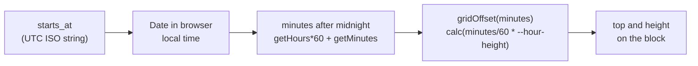
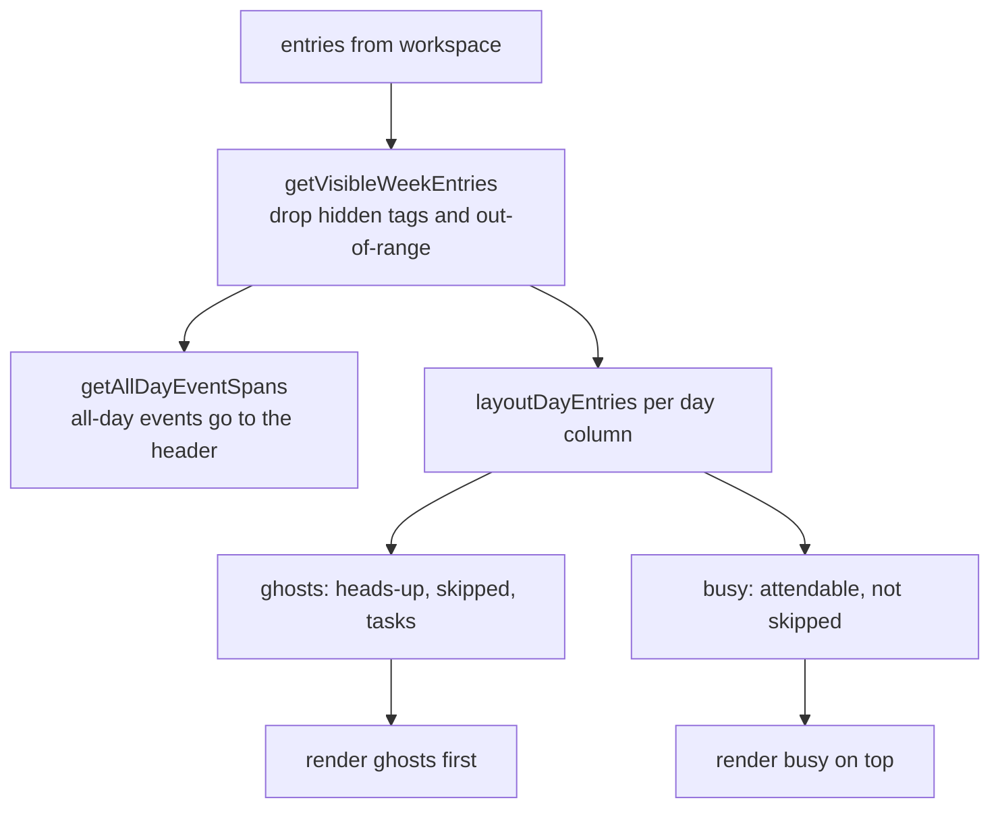

# Frontend

React 19, Vite, TypeScript, and TanStack Query. Dates use `date-fns`. The week grid is custom code, not a calendar library.

## Where things live

```text
frontend/src/
  main.tsx                 QueryClient and providers
  App.tsx                  auth gate: signed out -> AuthScreen, signed in -> CalendarApp
  CalendarApp.tsx          coordinator: calendar range, drawers, composer, sidebar
  types.ts                 TypeScript mirror of the API JSON
  lib/                     shared helpers (api.ts, queryKeys.ts, queryInvalidation.ts, calendar.ts, timeline.ts)
  hooks/                   generic hooks only (useMediaQuery, useCurrentTime, useActionMutation)
  components/              shared UI and app shell (TopBar, Sidebar, Drawer)
  features/<name>/         one folder per feature: components, hooks, pure logic, tests
  styles/                  CSS. tokens.css holds colors and layout variables.
```

- **Start at `CalendarApp.tsx`.** It connects the pieces. `App.tsx` only shows the login screen until there is a user.
- Put code in `features/<name>/` by default. Use `components/` for shared UI, `hooks/` for generic hooks, and `lib/` for helpers that two or more features use.
- Import from the source file. There are no `index.ts` barrel files.
- Naming:
  - `XPanel` loads and changes data (`ComposerPanel`, `RemindersPanel`).
  - `XDrawer` is presentational and gets everything through props.

## Server state

All server data lives in TanStack Query. There is no Redux or other global store.

- **Keys:** `lib/queryKeys.ts`, for example `["workspace"]`, `["reminders"]`, `["transit-card", from, to]`.
- **Invalidation:** `lib/queryInvalidation.ts`. Each helper names one user action and the keys it changes. `invalidateWorkspace` also refreshes reminders, because reminders copy the event's title and times.
- **API wrapper:** `lib/api.ts` sends cookies, throws on non-2xx with the server's text, and returns `undefined` for `204`.
- **Workspace query:** `features/timeline/useWorkspace.ts` fetches the whole timeline and all tags. The grid filters the visible days in memory.

### Mutation patterns

1. **Plain `useMutation`** with `onSuccess` calling an invalidation helper. Used for tags, events, and sign-in.
2. **`useActionMutation`** (`hooks/useActionMutation.ts`). Resolves to an error message or `null`, so a panel can show the error inline.
3. **Optimistic update**, only for task completion. The cache changes first, rolls back on error, and refreshes when settled.

Logout does not invalidate the current-user query. It sets it to `null`. A refetch would return `401`, and a failed refetch keeps the old data, so the signed-in screen would stay.

## The week grid

The grid places items by **minutes after local midnight**.



- `gridOffset` (`lib/calendar.ts`) returns a CSS `calc()` string, not pixels.
- `WeekCalendar` sets `--hour-height` from the space under the header, divided by the zoom level's visible hours (24, 16 or 12, the `visibleHours` preference set from the week header). It is clamped between `2rem` and `5rem`. Changing zoom keeps the same hour at the top.
- The grid always has 24 rows.
- Three days show on phones. Seven show on larger screens.

### Layout pipeline



- **Busy vs ghost:** busy entries take up time. Ghosts are faint and do not count as busy. Busy blocks paint over ghosts.
- **Occupied range:** includes commute before and after, and mandatory gathering. `getOccupiedRange` (`lib/timeline.ts`) computes it. It is cached in a `WeakMap` by object identity, so refetched data gets fresh results.
- **Overlaps** (`getHorizontalPlacements`): events whose occupied ranges overlap and that start within an hour of each other sit side by side in equal columns, and an event reuses a column that is free by its start. An event that starts later never covers the left 40% of a block it overlaps, so that block's title, time and end stay visible. It takes the widest free stretch, preferring the right: over one full-width block that is a cascade, and over several columns it fits inside the rightmost one. Tasks stay full width. Busy and ghost layers are placed separately.
- **Compact text:** each entry is a CSS size container. A block about one line tall shows its start time and title on one line; a narrow block shows only its title, wrapped. The article's `title` tooltip always has the full text.
- **Multi-day timed events** are split into one segment per day.
- **Tasks** are fixed 90-minute blocks at their deadline, on the deadline's day.
- **Elapsed:** the occupied range has ended. An event is not elapsed until its commute home is done.

### Time zones

- Rendering uses the browser's local time. The API sends UTC.
- Saving converts local time to ISO with `new Date(local).toISOString()`.
- Sunrise and sunset arrive as `HH:MM` strings. They are parsed with a regex, not `Date`, so no time zone applies. This is intentional.
- Transit-card days are `YYYY-MM-DD` strings.
- **Daylight saving is not handled.** On a clock-change day, items after the change can be up to an hour off in real elapsed time. No test covers this.

### Interaction

- Clicking an empty spot opens the composer at the nearest whole hour, clamped to 0 to 22.
- Clicking an entry opens it for editing and does not create a new event.
- On phones, a horizontal swipe of at least 60px, with vertical movement at most half the horizontal, moves the range by the number of visible days.
- Dragging an own timed event or a task moves it (`useEntryDrag`, math in `dragMove.ts`). With a mouse or pen, a press becomes a drag after 4px of movement, so a click still opens the item. A finger has to hold still for 300ms first; moving sooner leaves the touch to scrolling and the day swipe. While a finger drags, `touchmove` is cancelled so the grid doesn't scroll. That needs a non-passive listener that already existed when the touch began, so one stays on the window, plus one on the pressed element, because the dragged block is redrawn (e.g. into another day) and its touch events keep going to the removed element. The drag's `pointerup` is marked `defaultPrevented` so the swipe handler ignores it. The start (a task's deadline) snaps to the nearest half hour, and the duration is kept. While dragging, a moved copy of the item goes through the normal day layout, so the preview is exactly what is saved. Dropping saves through `moveItem`, which updates the cache at once and rolls back on failure. The hook keeps drawing the item at its new place until that save settles, because the cache update reaches React a moment after the drop and the item would otherwise flash back. Holding the pointer within 40px of the top of the visible hours (under the sticky day headings) or of the bottom scrolls the grid, faster nearer the edge, and the item follows. Escape cancels. Shared and all-day events can't be dragged, and there is no resizing.

## The composer

Creating an event is a chain of requests. [Walkthrough 1](walkthroughs.md#walkthrough-1-create-an-event) shows each step.

1. `POST /api/events` creates the event.
2. Each extra tag: `POST /api/timeline/{id}/tags`.
3. Each reminder: `POST /api/events/{id}/reminders`.

When editing, tags change in this order:

1. attach new tags;
2. save the event (`PUT`);
3. remove old tags.

The server refuses to remove the current main tag, so this order lets you change the main tag.

The steps run one after another, with no rollback. See [gotchas](gotchas.md#a-failed-save-can-leave-half-an-event).

## Quick add

- `QuickAddBar` sends text to `POST /api/events/parse`.
- `resolveDraft` turns relative dates into local dates.
- The draft opens the composer prefilled, with warnings above the form. Nothing is saved until Save.

## Styles

- `styles/tokens.css`: colors and layout variables. Change colors here.
- `styles/calendar.css`: the grid, about 840 lines.
- `index.css`: global reset. `App.css` imports the other style files.
- The phone breakpoint is 640px. CSS variables cannot be used in media queries, so the value appears in `lib/layout.ts` and in `@media` rules. Change both.

## Shared building blocks

| Name                | Where                          | Use it for                                              |
| ------------------- | ------------------------------ | ------------------------------------------------------- |
| `api<T>()`          | `lib/api.ts`                   | Every server call                                       |
| `useActionMutation` | `hooks/useActionMutation.ts`   | Actions that show an inline error                       |
| `useMediaQuery`     | `hooks/useMediaQuery.ts`       | Phone or desktop layout                                 |
| `useCurrentTime`    | `hooks/useCurrentTime.ts`      | Ticks every 60 seconds, for "now" lines                 |
| `Drawer`            | `components/Drawer.tsx`        | Side panels                                             |
| `DateTimeField`     | `components/DateTimeField.tsx` | Date and time input that follows the 12/24-hour setting |
| `cx`                | `lib/classNames.ts`            | Joining class names                                     |
