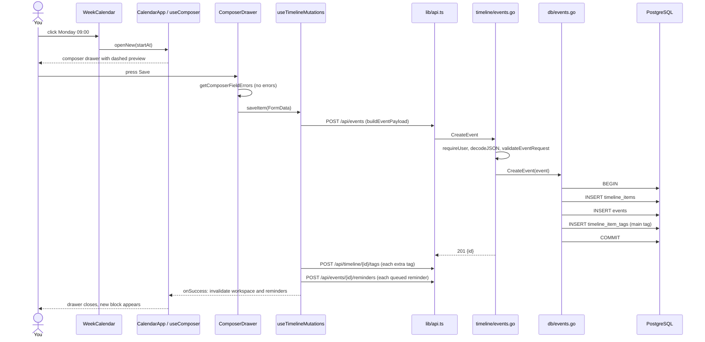
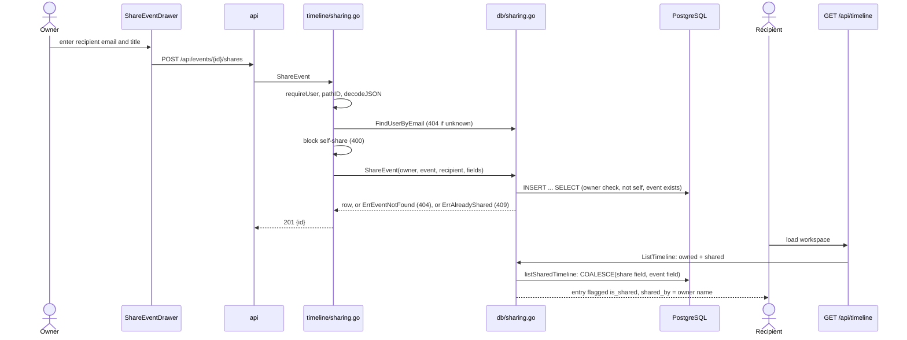

# Walkthroughs

Two requests, traced from the screen to the database and back. Each step names a file, so you can follow along. Read [architecture](architecture.md) first.

## Walkthrough 1: create an event

You click an empty spot in Monday's column, fill in the form, and press Save.



### Steps

1. **Open the composer.** `WeekCalendar` calls `onDayClick`. `CalendarApp.tsx` passes the click to `getClickedEventStart` (`features/calendar/timelineView.ts`), which rounds to the nearest hour, then to `composer.openNew` (`features/composer/useComposer.ts`). The new event gets the default tag, or the first tag if there is no default.
2. **Render the form.** `CalendarApp` renders `ComposerPanel` with a `key` that changes per item, so each open starts fresh. Most inputs are uncontrolled: `FormData` reads them on save. A few flags (all-day, skipped, kind) and reminders live in React state.
3. **Validate.** `ComposerDrawer` calls `getComposerFieldErrors` (`formValidation.ts`). It checks the browser's validity, that the end is after the start, that at least one tag is chosen, and that the main tag is one of them. Nothing is sent if it fails.
4. **Build the payload.** `buildEventPayload` (`timelineRequests.ts`) turns the form into JSON. It converts local times to ISO strings and minutes to seconds. All-day events drop commute, gathering, and approximate flags. Heads-up events drop commute and gathering. Blank text becomes `null`.
5. **Send.** `api("/api/events", { method: "POST" })` goes through the Vite proxy to `timelineHandler.CreateEvent` (`backend/cmd/server.go`).
6. **Handle on the server.**
   - `requireUser` (`timeline/handler.go`) calls `auth.RequireUser`. That reads the `calendar_session` cookie, hashes the token, and looks up the session and user (`auth/handler.go`, `db/users.go`).
   - `decodeJSON` reads the body into `eventRequest` (`requests.go`).
   - `validateEventRequest` checks the title, kind, end-after-start, and the commute and gathering rules (`validation.go`).
7. **Store.** `Store.CreateEvent` (`db/events.go`) runs one transaction:
   - checks that the main tag belongs to the user;
   - inserts the `timeline_items` row;
   - inserts the `events` row;
   - inserts the first `timeline_item_tags` row, for the main tag.

   Any failure rolls back everything.

8. **Respond.** `201 {"id": ...}`.
9. **Finish in the browser.** `useTimelineMutations.saveItem` (`features/timeline/`) then sends each extra tag and each queued reminder as separate requests. See [gotchas](gotchas.md#a-failed-save-can-leave-half-an-event).
10. **Refresh.** `onSuccess` calls `invalidateWorkspace`, which marks `["workspace"]` and `["reminders"]` stale. TanStack Query refetches them, and the new block appears.

## Walkthrough 2: share an event

You share Monday's dentist appointment with your partner under a different title ("Sam: dentist"). Your partner then sees it on their own timeline.



### Steps

1. **Send.** `ShareEventDrawer` (`features/sharing/`) posts `recipient_email` and the optional title. A blank field means "same as the event".
2. **Check the caller.** `ShareEvent` (`timeline/sharing.go`) calls `requireUser`, then reads the event ID from the path.
3. **Find the recipient.** `findUserByEmail` lowercases the email and looks it up. Unknown: `404`. Yourself: `400`.
4. **Normalize.** `normalizeShareFields` trims each field and stores blanks as NULL. NULL means "use the event's value".
5. **Insert.** `Store.ShareEvent` (`db/sharing.go`) is one statement. This is a simplified view. The real query also sets the share fields:

   ```sql
   INSERT INTO event_shares (...)
   SELECT ...
   FROM events AS e
   JOIN timeline_items AS item ON item.id = e.timeline_item_id
   WHERE e.timeline_item_id = $event
     AND item.user_id = $owner
     AND item.user_id <> $recipient
   ```

   The `WHERE` clause checks three things at once: you own the event, it exists, and the recipient is not you. No row inserted means `404`. A repeat share violates the unique constraint and returns `409`.

6. **Recipient reads.** `ListTimeline` (`db/timeline.go`) adds `listSharedTimeline`. For each shared event it takes title, description, URL, and location from the share if set, otherwise from the event. Times, all-day, kind, and gathering always come from the event.
7. **What the recipient does not get.** Tags, the main tag, commute, and the skipped flag. `populateTimelineTags` loads tags only for the caller's own items, so shared entries have none. Keep that filter when you change tag code.
8. **Recipient edits are blocked.** `PUT` or `DELETE` by a recipient returns `404`, because the owner check fails. The exception is reminders, which the recipient can set privately (`db/reminders.go`).

## Next

- [Data model: sharing](data-model.md#sharing) for the rules behind the share table.
- [Gotchas](gotchas.md) for where a trace looks right but is not.
